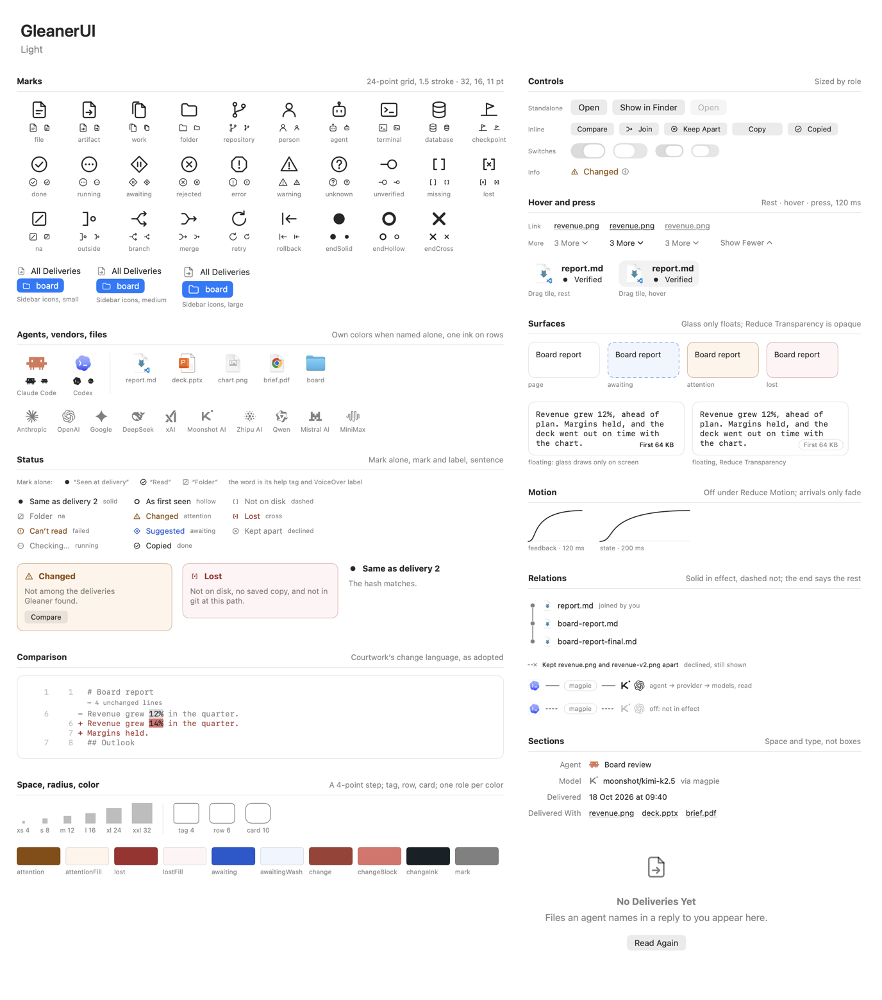
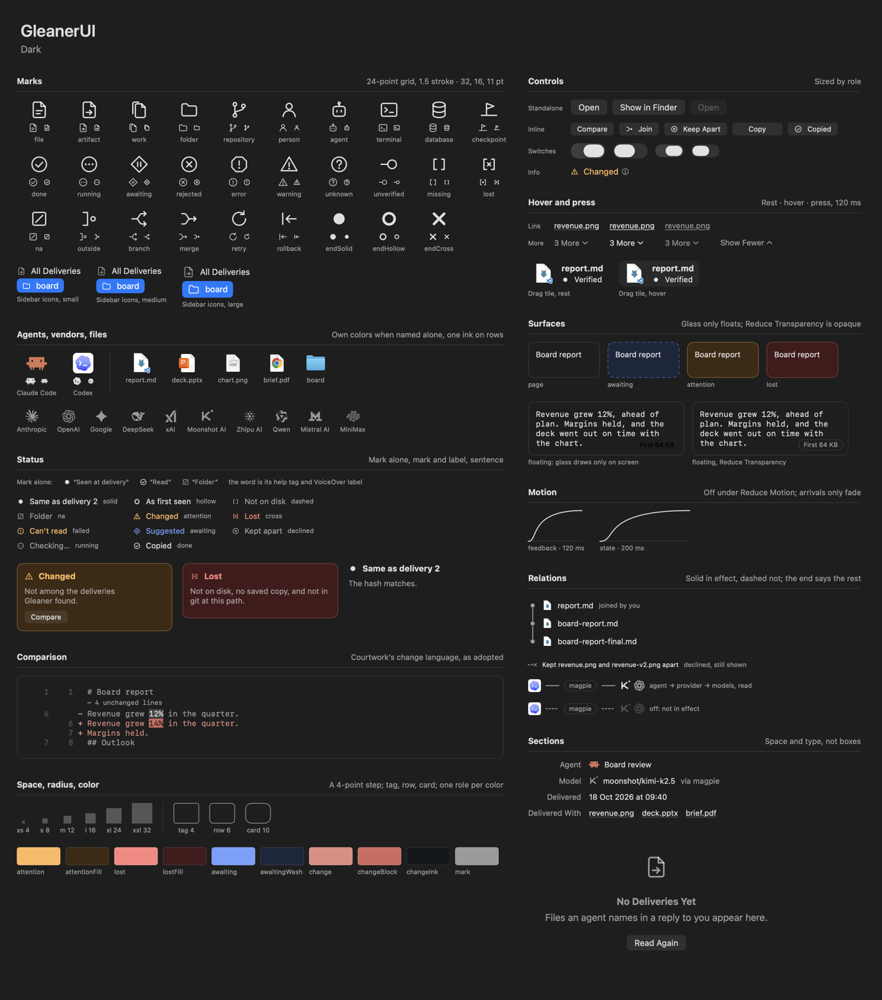
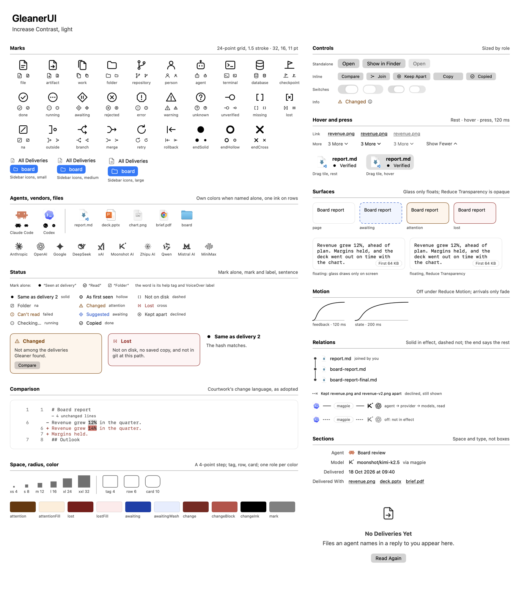
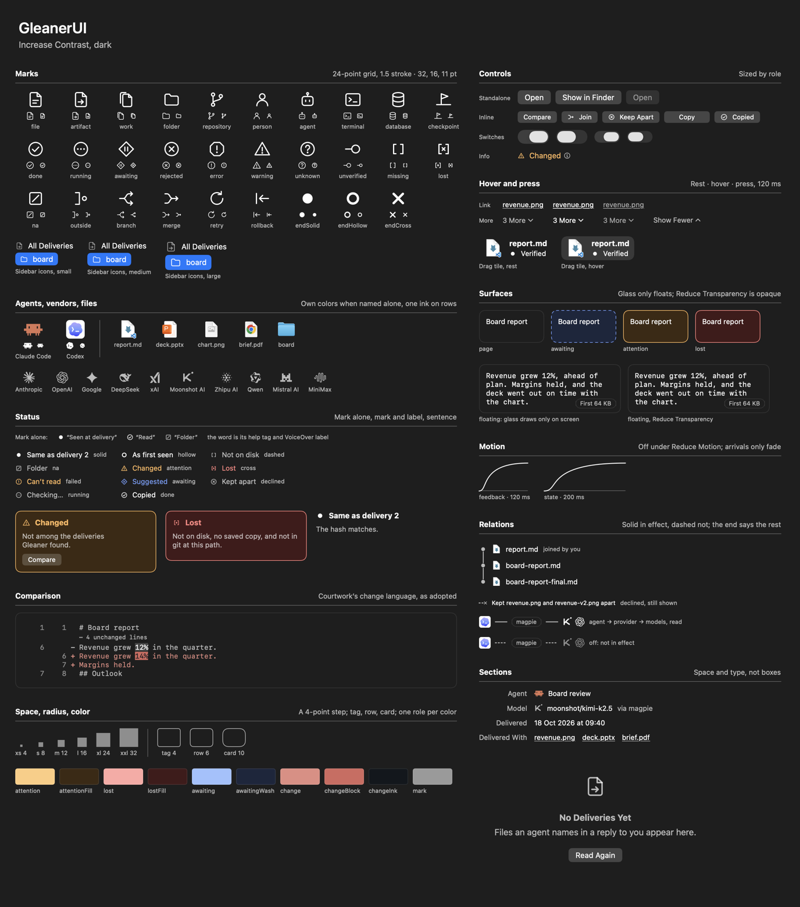

# Components

Opus, 2026-10-18. The owner asked for Gleaner's scattered interface pieces to become an independent component library, with each aspect designed on its own: native marks and icons, materials, hover and press, controls, status marks and motion. They also asked for a gallery that draws all of it.

- **Yardstick:** airy, clean, clear.
- **References:** mature first-party Mac apps (Finder, Mail, System Settings) and [Magpie](https://github.com/yetone/magpie).
- **Courtwork:** only small defamiliarizing touches. The comparison is the one the owner adopted ([diff-and-references.md](diff-and-references.md)), and it is kept as it was.
- **Grammar:** the Praxis kit's, as [window-polish.md](window-polish.md) reads it for a native window.

The window looks as it did. The refinements are listed under [What changed in the window](#what-changed-in-the-window).

## The library

`GleanerUI` is a target of its own (`Sources/GleanerUI`). It imports only SwiftUI and AppKit. It holds no Gleaner wording beyond a few control words ("Copied", "More Info", "3 More", "Show Fewer"), and no type from `GleanerCore`. The app binds its library to the components in three places:

- `AgentMark+Provider.swift`: an agent's mark from the `Provider` a log names (`AgentMark(provider:)`).
- `ComparePane.swift`: `DiffItem.items(_:)` turns `TextDiff`'s rows and folds into the comparison's lines.
- `Wording.swift`: every sentence, label and `Statement`. `Wording.provider` takes the agent's name from `AgentMark.Agent`, which owns it, as `ModelVendor` owns the vendors' names.

Each component's look is a function of its state. The views that track a pointer (links, `MoreButton`, `hoverWash`) draw each state from one face, so the gallery can draw the hover and press states that no pointer reaches off screen. Those faces are internal: the gallery reaches them through `@testable import`.

| Aspect | API | File |
|---|---|---|
| Marks | `Glyph`, `GlyphView`, `GlyphLabel`, `RowGlyph` | `Glyph.swift`, `SVGPath.swift` |
| Brand marks | `AgentMark` (`.claudeCode`, `.codex`), `ModelVendor`, `VendorMark` | `AgentMarks.swift`, `VendorMarks.swift` |
| File icons | `FileIcon` | `FileIcon.swift` |
| Status | `Mark`, `Statement`, `StatusMark`, `StatusLabel`, `StatusPanel` | `Status.swift` |
| Color | `Palette` | `Palette.swift` |
| Surfaces | `Surface`, `.surface(_:)`, `.surface(_:in:)` | `Surfaces.swift` |
| Hover and press | `.hoverWash(_:)`; links and `MoreButton` carry their own | `Surfaces.swift`, `Controls.swift` |
| Controls | `ControlRole`, `.controlRole(_:)`, `Switch`, `LinkButton`, `MoreButton`, `InfoButton`, `CopyButton` | `Controls.swift` |
| Relations | `RelationEnd`, `RelationLine`, `RelationNode` | `Relations.swift` |
| Motion | `Motion` (`.feedback`, `.state`, `arrive`), `announce` | `Tokens.swift` |
| Layout | `Space`, `Radius`, `DetailSection`, `InfoRow`, `EmptyState`, `FlowLayout` | `Tokens.swift`, `Layout.swift` |
| Comparison | `DiffLine`, `DiffItem`, `DiffRows` | `DiffRows.swift` |

## Each aspect, designed on its own

### Marks and icons

- **Where marks go.** Native chrome keeps the system's SF Symbols: the toolbar, menus, ⓘ, disclosure chevrons, and the system's own empty states. The toolbar's Sources button follows it: connections (`point.3.connected.trianglepath.dotted`), or `exclamationmark.triangle` in amber when a source needs a look. Gleaner's marks go only where they carry one of Gleaner's meanings: a kind of object, a state, a flow, a relation's end. The sidebar's rows carry Gleaner's marks, drawn to the row as SF Symbols would be.
- **How they are drawn.** Each mark is SVG geometry on the kit's 24-point grid, with a 1.5 stroke that scales with the size, never under a point, and round caps and joins. The parts are read once, not on every redraw.
- **Words.** A mark always stands for a word, in one of the three tiers under [Status marks](#status-marks): beside it, or, when all is as it should be, in its help tag and as its VoiceOver label.
- **In a sidebar**, `RowGlyph` follows the row as an SF Symbol would. It takes the person's sidebar icon size (14, 16 or 20) and turns white on an emphasized selection. The gallery draws the three sizes, and the mark's answer to an emphasized selection on a stand-in for it: the system draws its own selected row only on screen.
- **Brand marks** are lobe-icons' drawings, the set Magpie bundles. An agent appears in its own colors where it is named on its own, and in one ink where it repeats on rows. A model's vendor is always one ink, a step below the agent. A model that matches no vendor gets no mark.
- **Files** are drawn with the icon Finder uses for their type, so no badge repeats the extension.

### Status marks

A state is said in three tiers, each only as far as it is needed:

1. **The mark alone** (`StatusMark`), for a state that is as it should be, as a Mac list marks only the exception. Its word is the help tag, and what VoiceOver reads. The Versions table marks each delivery this way.
2. **The mark and its label** (`StatusLabel`), one to three words, for a state that needs a look.
3. **The sentence**: why, behind ⓘ, or inline in a `StatusPanel` where the person must decide what to do.

`Mark` names the eleven states. Each has a silhouette that stays distinct in grey, and a color that only repeats it. "Not on disk" is brackets around nothing; "lost" puts a cross between them (`Glyph.lost`, Gleaner's own), so the two never differ by color alone.

- **Ink:** confirmed (solid), not confirmed (hollow) and done.
- **Secondary:** no value, doesn't apply, declined and running.
- **Amber:** needs a look and couldn't read.
- **Red:** gone.
- **The accent:** awaits the person.

`StatusPanel` stands on a tinted surface only when the person must look or something is gone. Otherwise it is plain text in its place, so boxes never stack inside boxes. `Mark.surface` makes that choice once, for every panel.

### Color

`Palette` has the few colors with a role. Everything else is the system's: label inks, separators, selection and materials.

| Color | Role |
|---|---|
| `attention`, `attentionFill` | Needs your look |
| `lost`, `lostFill` | Gone |
| `awaiting`, `awaitingWash` | The one accent: waits on the person's decision, and nothing else. Links are ink, so they never borrow it. |
| `change`, `changeBlock`, `changeInk` | Changed text in a comparison, and nothing else (Courtwork) |
| `mark` | A mark beside its words |

- **Under Increase Contrast**, every ink has a stronger value in light and in dark. A wash deepens a little in light, so it still parts from the window, and keeps its value in dark, where the edge and ink on it get stronger instead.
- **Dark under Increase Contrast** is new: the amber, red and accent inks had no stronger dark value before.
- **The comparison's colors** stay Courtwork's, with no stronger dark value.
- **`TokenTests`** checks that a contrast ink only ever moves away from its background, and that a wash deepens a little in light and holds in dark.

### Surfaces and materials

Grouping is done with space, alignment and type (Praxis references U04). Only five things stand on a surface of their own.

| Surface | For | Drawn as |
|---|---|---|
| `page` | A document: the preview, the comparison | The text background, a hairline edge, clipped to the card's corners (Finder's and Mail's previews) |
| `awaiting` | A suggestion | The accent's wash, with the kit's dashed edge for "not in effect yet" |
| `attention`, `lost` | A statement that needs a look, or about something gone | An amber or red wash and edge |
| `floating` | A small label over content that scrolls under it ("First 64 KB") | Liquid Glass on macOS 26 and later, the regular material before |

**Glass only floats.** The window's chrome (sidebar, toolbar, popovers, sheets) keeps the system's materials and glass. Content never stands on glass.

**Reduce Transparency and Increase Contrast.**
- **Floating:** it is opaque, with a hairline edge, so text never shows through it. In System Settings, Increase Contrast turns on Reduce Transparency too.
- **Other surfaces:** under Increase Contrast, their edges take the full ink.

`.surface(nil)` keeps the same view structure with nothing drawn. A statement that gains or loses its tint eases between the two instead of being replaced.

### Hover and press

Each control you can act on has three states: rest, hover and press. Hover only confirms what a control already says. Nothing needed is hover-only.

| Control | Hover | Press |
|---|---|---|
| System buttons (bordered, borderless, ⓘ) | The system's | The system's |
| Link (`LinkButton`) | Its standing underline darkens to the ink; the pointer is a hand | Dims to 60%, as a plain Mac button does |
| `MoreButton` ("3 More ⌄", "Show Fewer ⌃") | Secondary text takes the label ink; the pointer is a hand | Dims to 60% |
| The file to drag (`.hoverWash`) | A wash of the label ink: 6%, or 12% under Increase Contrast. The whole wash is the target, and the pointer and the drag share its rect | The drag itself |

Lists and tables don't wash their rows, as Finder and Mail don't: the system's selection is their feedback. Hover eases in at the feedback duration, and at once under Reduce Motion.

### Controls

A control's size follows its place, as in first-party apps.

| Role | Size | Examples |
|---|---|---|
| `standalone` (the default, `Switch`'s too) | The place's own: regular in a window, small for a grouped form's switches, as System Settings draws them | The detail's Open and Show in Finder, an agent page's switch, an empty state's way out, a sheet's buttons |
| `inline` | Small, so the row keeps its text's height | Compare, Copy, Join, Keep Apart, Undo, Try Again, a source row's switch |

`.controlRole(.standalone)` sets no size. A grouped `Form` sizes its switches without saying so in the environment, so any size set there would override it.

- **`Switch`** is the system's switch. Its label is for VoiceOver; the words beside it say what it switches.
- **`LinkButton`** goes somewhere and is ink with a standing underline. It is never the accent.
- **`MoreButton`** shows the rest of a list in place, or hides it again. At rest it reads in secondary text, as the list's notes do; its chevron, pointing where the list goes, is the standing cue that it is a command and not a count.
- **Marks on buttons** come in pairs: Join carries `merge` and Keep Apart `rejected`, the mark Corrections lists it by; Show Apart carries `branch`.
- **`InfoButton`** opens the sentence behind a label in a popover. The sentence is also its help tag and its VoiceOver value.
- **`CopyButton`** says "Copied" with the done mark in its own place for a moment. Both labels keep one width, so nothing beside it moves.
- **Bezels** stay the system's bordered buttons, with no custom bezel.

### Relations

The kit's relation grammar, as components: a line that is solid while the relation is in effect and dashed while it is not, ending in what it says of its far end (`RelationEnd`: confirmed, not confirmed, declined).

| Component | Drawn as | In the window |
|---|---|---|
| `RelationNode` | A node on a line drawn down a list: the line in from the row above and out to the row below, stopping at the end's edge | A work's files hung on one solid line with filled ends, because the person joined them (Project) |
| `RelationLine(inEffect: false, end: .cross)` | A short dashed line ending in a cross | A pair the person kept apart, still shown |
| `RelationLine(inEffect:)` | A line between two marks, with no end | An agent → its provider → its models' vendors, dashed while the agent is off (Sources) |

### Motion

| Token | Duration | Curve | For |
|---|---|---|---|
| `Motion.feedback` | 120 ms | out (0.2, 0, 0, 1) | Hover and press |
| `Motion.state` | 200 ms | out | A state switching, something arriving or leaving |

The kit's third duration, 240 ms for a move, has no token. Nothing in the window moves to a new place: a selection swaps at once, and nothing flies. It becomes a token when something does.

- **Calling a token.** A token is called with the person's Reduce Motion setting, as in `withAnimation(Motion.state(reduceMotion))`. It returns nil under Reduce Motion, so nothing moves.
- **Arrivals.** `Motion.arrive` rises 8 points as it fades in and leaves by fading only. Under Reduce Motion it only fades.
- **The model leads.** Motion follows the model, which has already changed. A new click reverses or replaces an animation, and nothing waits for one.
- **`TokenTests`** checks the durations, and that every token is off under Reduce Motion.

### Layout

- **Space:** a 4-point step: 4, 8, 12, 16, 24, 32. A detail's sections stand 24 apart, and the items inside them 8.
- **Radius:** three values: 4 for tags, 6 for a selected row in a table, 10 for cards.
- **`DetailSection`** titles a section as Finder's preview pane does: a heading, a rule, then the content.
- **`InfoRow`** labels facts as Get Info does, with the label right-aligned in its column.
- **`EmptyState`** draws its mark large, with a short title, one line, and what to do.

### Comparison

`DiffRows` draws Courtwork's change language as adopted.
- **Lines.** Context and removed lines are grey, and an added line is in the change color.
- **Words.** Only new words get the solid block with dark ink. Removed words sit on the neutral selection grey.
- **Markers.** Both line numbers and the `+`/`−` mark stay, so color never carries the difference alone.
- **Folds.** An unchanged run folds into "⋯ N unchanged lines", which opens in place.

Its language is unchanged. Two things changed around it:
- **Input.** It takes `DiffLine`s and folded runs, so the view doesn't depend on `GleanerCore`. `TextDiff` still decides what folds.
- **Size.** The rows are as tall as they are, measured, up to 420 points, past which they scroll; they used to take a height guessed from their count, so a short diff floated in empty space. They stay at the top left, and a fold's label starts at the text column.

## The gallery

```bash
GLEANER_GALLERY=<folder> swift test --filter GalleryTests
```

`Tests/GleanerUITests/GalleryTests.swift` draws every component on one sheet in four appearances: light, dark, and Increase Contrast in each. It writes `gallery-<appearance>.png`. It follows the tour's method: the real views, in an off-screen window, drawn with `cacheDisplay` over the window's background. It depends on `GleanerUI` alone, which shows that the library stands on its own. The sheets below are at half resolution; the run draws them at full.

| Light | Dark |
|---|---|
|  |  |
| **Increase Contrast, light** | **Increase Contrast, dark** |
|  |  |

**What an off-screen window can't draw.** The sheets are honest about it.

- **Increase Contrast's colors.** An appearance named for high contrast resolves to plain Aqua when an app makes one, and SwiftUI's contrast setting doesn't reach AppKit's colors. So the contrast sheets draw:
  - for real, everything that keys on SwiftUI's contrast: the stronger edges, the wash, the link's underline, and the opaque floating label;
  - the palette's contrast values, as swatches from its own table.

  Status inks and system colors on those sheets show their standard values. In the window, the system's setting picks the contrast values.
- **Liquid Glass** composites in the window server, so the plain floating label draws without its glass; in dark it is unreadable there, and the sheet says the sample isn't representative. Its Reduce Transparency fallback draws in full. Drawing through a real window on screen would need screen recording, which a test shouldn't ask for.
- **The sidebar's selected row** is the system's, drawn only on screen. The sheet draws `RowGlyph` on a stand-in for it.
- **Controls draw as in a window behind others.** The test host isn't the active app, so a switch that is on draws grey, not in the accent.

## What changed in the window

The tour (`GLEANER_TOUR`) was drawn before and after the move and compared pixel by pixel. Every picture is the same, apart from what changes between any two runs:
- clock times;
- the synthetic home's temporary path;
- the Copy button that follows that path's width.

The tour's last picture, the sheet of every mark, is now part of the gallery, which draws it in every appearance.

A design review asked for the refinements below, and they are deliberate. Those the tour shows:
- **"Lost"** draws a cross between the brackets, apart from "not on disk".
- **Keep Apart** carries its mark beside Join's.
- **Versions** shortens its dates, as Mail does, when the table is too narrow for its labels, for every row at once, so "Same as delivery 2" isn't cut to "Sa…d 2". The full date stays in the help tag.
- **The comparison** is as tall as its rows, up to 420 points.
- **"3 More"** carries its chevron.

These show only under a setting, a pointer or a newer system, and none of them is in the tour:
- **Increase Contrast:**
  - edges of tinted panels and suggestions take the full ink;
  - a link's standing underline goes from tertiary to secondary label;
  - the hover wash is 12%;
  - the floating label is opaque;
  - the amber, red and accent inks have stronger dark values.
- **Reduce Transparency:** the floating label is opaque, with a hairline edge.
- **macOS 26 and later:** the floating label stands on Liquid Glass instead of the regular material.
- **Press and hover:**
  - links and quiet commands dim when pressed;
  - "3 More" takes the label ink under the pointer;
  - the file at the top of the detail washes, takes the pointer and drags over one rect, the wash's, 8 points wider each side than its text.
- **The toolbar's Sources button** takes SF Symbols, as the toolbar's other buttons do.

## Adding a component

- **Find its aspect first.** Use the aspect's tokens and its one rule. A new color needs a role no other color has.
- **Keep it free of the library.** It takes plain values. Wording stays in the app, and nothing imports `GleanerCore`.
- **Make its look a function of its state.** Give the gallery a face for each state a pointer or the system decides.
- **Give it a public initializer**, and a doc comment that says what it is for and what it never does.
- **Draw it in the gallery** in every appearance. Then run the tour to see that the window is unchanged.

## Checked

- **`swift test`:** 221 tests pass. `MarkTests` (was `GlyphTests`) and `TokenTests` are in `GleanerUITests`, and `DiffItemTests` checks that each fold carries the lines it stands for.
- **The tour:** pictures unchanged, as above.
- **The gallery:** drawn in all four appearances.
- **Not checked:**
  - real hover and press;
  - Liquid Glass and Increase Contrast's colors in a running window;
  - VoiceOver on the switches;
  - the switches by mouse and keyboard.

  These need a person at the window.
