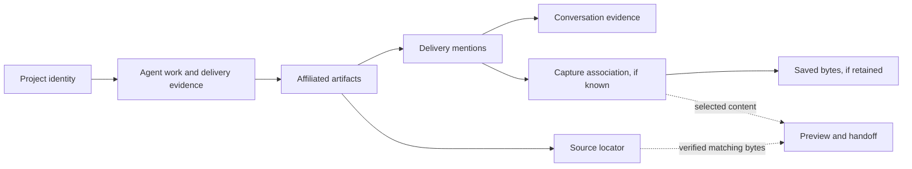

# Optional reference notes: objects, affiliation and instances

Status: independent exploration for review, 2026-10-17. Current inspected baseline: [`79d724d1228a4b748572958dcbdd22aa6b7da142`](https://github.com/lesPrivilege/gleaner/tree/79d724d1228a4b748572958dcbdd22aa6b7da142), including changes since the initial `d981801` review. This is a design reference, not an adopted architecture, implementation or change to the ratified spec. Final product and visual decisions remain with the local design owner, Opus.

**Project is the primary affiliation. Explore how little a person needs on screen to review and retrieve its outputs.** They should be able to answer: Which project is this for? Is it relevant? What am I looking at? Where did it come from? Can I take this version away? The semantic hierarchy is project → work/deliveries from multiple agents → artifacts, versions and provenance. It does not mandate a visual tree or an agent-management screen. Organization within that hierarchy remains open.

These are optional background notes, not a feature list or canonical schema. Start with the [smaller composition explorations](control-panel-explorations.md); retain only structure needed to support a demonstrated review task.

The existing direction supports the core task: search remembers the request, delivery excerpts establish origin, originals stay in place, and unavailable records remain useful. The next improvement is to make those relationships consistent across results, preview and actions. [Source evidence and audit limits](design-review-evidence.md) accompany these explorations. No rendered visual audit was possible in this review; visual and motion judgments remain open.

Current main already adds the native library, capture registry, saved copies, preview code and verified staging. The earlier single-term search, late-observed saved-copy handoff and older-hash reversion cases were corrected; they remain regression scenarios, not unimplemented requests. The remaining exploration concerns composition, affiliation, ambiguous relationships and incomplete validation.

## Three alternatives within a project

| Direction | Primary organization and real task | Useful consequence | Cost and question for Opus |
|---|---|---|---|
| **A. Project output catalog** | Within a project, one result per artifact, with matching delivery choices; artifact detail holds history. “Find Atlas's demo, then choose the earlier cut.” | Output identity stays stable across agents; repeated handovers do not flood browsing. Closest to the prototype's result shape. | Grouped search can hide the actual match. Does showing the matching delivery and a match count remove that ambiguity without making rows too dense? |
| **B. Project delivery ledger** | Within a project, one entry per handover/reply, with explicitly named artifacts inside; preview selects an artifact/capture in that event. “What did the agents hand over for Atlas's captions work?” | The request and original evidence lead naturally. Several outputs from one reply stay related without pretending they form a bundle. | Repeated deliveries can crowd results. Is an artifact-history link enough for comparison, or does the extra output choice slow retrieval? |
| **C. Project review shelf** | Within a project, a short personal selection of outputs sits above the complete catalog or ledger. “Review the report, diagram and build together before sharing.” | Related outputs from several agents/replies can be brought together for human assessment without inventing a task ontology. | Manual maintenance and hidden items can mislead. Is a small, clearly labeled selection worth the added view state? Keep the complete project view one action away. |

Do not rank these from taste. Try the same older-delivery search, cross-project duplicate-name search, and multi-output-reply task in each. Record mistaken-version selections, unnecessary navigation and the information the reviewer needed. A hybrid may emerge, but it should not inherit all three navigation systems by default. Global search/recent views are shortcuts across projects; they always show the relevant project affiliation, including unresolved or multiple affiliation.

## 1. Working vocabulary to test across alternatives

These are working dispositions for discussion, not a canonical schema or settled product decisions beyond project primacy. They help compare the alternatives and preserve the spec's Session, Delivery Mention, Locator and Capture distinctions. The logical-deliverable alternatives in §10 may change which identities are persisted. Stable projection identities need not each become a screen. “Work” can be represented by requests and handover evidence; it need not introduce a Work Unit lifecycle.

| Concept | Candidate treatment and minimum useful information | Reader-facing role |
|---|---|---|
| Artifact | **Possible stable output handle**, initially anchored to the first locator. A stable handle survives an explicitly confirmed relink. Different paths are not automatically merged by hash, name or project. | One output and detail surface with visible project context. A file or explicitly delivered folder can be an artifact. |
| Delivery mention | **Evidence unit in these alternatives.** Stable mention/reply key, artifact/locator link, request excerpt, reply excerpt, source reference and nullable delivery time. Group mentions from the same reply by an event key; do not infer a bundle from that grouping. | Selectable delivery history. “Also handed over in this reply” may link sibling artifacts in secondary detail. |
| Conversation / session | **Consider one readable origin label** in the UI; retain provider and session identity internally. A conversation can hand over several artifacts, and one artifact can have deliveries from several conversations. | Compact origin on the selected delivery; deeper source evidence on demand. No mandatory conversation browser. |
| Locator / file | **Keep location facts distinguishable from artifact and bytes.** Original target, resolved path, worktree/repository context, availability and verification time. Access denied or failed checks must be distinguishable from confirmed absence. | Where the source is now; contextual reveal and path actions. No independent global Files layer. |
| Capture / saved copy | **Retain.** Capture identity, hash, observed time, provenance, size and optional saved-copy reference/time. Stored bytes do not prove when those bytes were delivered. | Availability and observation certainty beside the selected version. Storage internals stay secondary. |
| Version | **A possible content projection**, scoped to an artifact and its capture associations; it is not a synonym for a reply or a hash. Same bytes delivered twice yield two evidence events but one content version. Unobserved delivery bytes remain unknown. | Delivery selection resolves a particular capture or an explicitly unavailable/uncertain state. A current undelivered file is a separate choice. |
| Project / affiliation | **Promote to primary semantic context.** A durable project reference with explicit affiliation is one candidate mechanism for outliving roots, sessions and worktrees. Exact identity/storage design is open; inferred evidence and human correction remain distinct. | Primary context for work and outputs, including global search results. No scheduling, agent orchestration or project-management lifecycle. |
| Outline / summary | **Derive when useful**, with source and version binding; no mandatory standalone schema or authored project overview. | Navigation within the chosen content and concise evidence for relevance. |
| Worktree / branch / runtime | **Retain as context**, not navigation roots or artifact ownership. | Disambiguate locations and origins only when needed. |
| Review workflow, quality score, generated project synopsis, release group | **Defer.** The spec defers approvals and release groups; present extraction cannot substantiate quality scoring. | Human review uses real content and attributed evidence. |
| Process feed, raw transcript outline, schema browser | **Remove from the persistent reader path**, not from necessary diagnostics. | Operational detail belongs in source details or diagnostics. |

The relationships relevant to one possible composition are (conceptual links, not database tables or required screens):

An association to a capture first observed after delivery retains that uncertainty. Deduplicating stored bytes must not merge provenance. See [spec data and time semantics](https://github.com/lesPrivilege/gleaner/blob/79d724d1228a4b748572958dcbdd22aa6b7da142/docs/SPEC.md#L52-L97).

## 2. Project identity, affiliation and navigation

In direction A, start at **Project → outputs → selected output**. Direction B uses **Project → handovers → selected output**. Direction C adds a personal review selection within the project. A project selector, sidebar or project landing list are all possible; none requires a permanent three-column window. Global search can open a selected output directly with its project context intact.

Project identity is not one agent, session, directory or Git checkout. The baseline spec describes a derived label; the project-first product decision therefore needs an explicit spec revision, while its storage and interaction design remain open. Consider two affiliation mechanisms: **root/repository associations with editable exceptions**, which reduce repeated assignment, or **per-delivery affiliation with reusable suggestions**, which handles cross-project work precisely but asks for more review. A narrow combination may be warranted; do not silently convert suggestions into facts.

Keep the semantic objects separate: a **logical project** is the human's endeavor; a **project folder** is a location; a **workspace** groups working locations; a **Git repository/worktree** describes source-control relationships; a **provider project container** groups activity in an agent application; and a **session working directory** is execution context at a particular time. None alone defines the others. Bindings can be many-to-many, and changes in binding need not rewrite historical deliveries.

| Situation | Sound affiliation evidence and correction boundary |
|---|---|
| Linked worktrees | Shared Git repository metadata can establish a repository relationship; it does not alone prove product/project identity. Once that repository is associated, inherit the suggestion and retain each original location. Keep historical affiliation after worktree deletion. |
| Several repositories or non-Git folders | Explicitly associate several roots with one project. Support non-Git roots without requiring Git or moving content. A root is supporting evidence, not the project identifier. |
| Same-named roots, moved folders or ambiguous sessions | Basenames are display hints only. Keep a short distinguishing location and an unresolved/ambiguous affiliation state until evidence or a person resolves it. Do not discard the deliveries. |
| Cross-project reference | Distinguish where the work was delivered from a project that references it. Show the context relevant to the result; retain the original origin. Reuse need not clone the artifact or rewrite its source delivery. |
| User correction | Change an index-owned affiliation with an explicit scope: this output/delivery or a root's future/default association. Preview affected items for broad corrections and allow reversal. Preserve original evidence and the correction basis. |

Affiliation evidence could be reviewed in this order: an explicit, scoped human assignment; a previously confirmed applicable binding; verified repository/worktree relationships supporting that binding; clues from provider containers, workspaces and cwd; then weak name/path/remote hints. This is a proposed conflict policy, not a confidence score. Conflicting confirmed bindings remain multiple or ambiguous until resolved; a weaker hint never overrides an explicit assignment. Matching remote URLs alone never merge logical projects. Track the origin and scope of a binding; add effective dates only where a changed association makes them necessary.

Three concrete cases illustrate the boundary:

- An agent-owned external worktree at a fictional `agent-store/worktrees/run-42` belongs to the Atlas repository through Git's worktree metadata. Its confirmed repository affiliation can connect it to Atlas even though no ancestor directory is named Atlas. Show “Atlas · external worktree” in normal use; expose the Git relationship and location under affiliation details.
- A session starts in Atlas documentation and later changes cwd to Beacon tooling. Attach each delivery's recorded working context and supporting bindings at that point; do not assign every output using the session's first or current cwd. If a reply writes outside cwd or the bindings disagree, show unresolved affiliation rather than guessing.
- A provider container named “Client work” covers Atlas and Beacon repositories. Retain that container as source context, not as the logical project. A workspace may likewise contain both. Let the user assign or correct the affected deliveries without renaming the provider container or moving files.

A delivery's project context can differ from the artifact's physical location. An artifact used by two projects can appear in both without duplication or identity merging. Browse counts count unique outputs in the scope; matching delivery counts are stated separately. Agents/providers and sessions explain contributions but need not become mandatory sublevels. Avoid a generated “project summary” as a substitute for these affiliations.

Do not turn the semantic hierarchy into a mandatory chain of Project → Agent → Conversation → Delivery → Artifact → Version → File. The reader should be able to enter by remembered topic, see the project immediately, and inspect contribution/provenance when needed.

## 3. Candidate persistent information and disclosure

“Persistent” means visible in the relevant result/detail state without opening an inspector. It does not require every element to be fixed on screen while scrolling.

| Surface | Persistent, useful for human review | Secondary disclosure |
|---|---|---|
| Library | Project context, search, active scope/filters, intelligible output count, list selection; concise notice if indexing is incomplete | Source configuration, parser failures, scan statistics |
| Result | Name/type, project, matching request or reply excerpt, matching delivery/date, selected match's availability/uncertainty, additional-match count | Other matching deliveries, full excerpt, location disambiguation beyond the short qualifier |
| Selected artifact | Name; selected delivery/date; provider and readable conversation origin; short request and delivery evidence; real preview or its precise absence reason; preview source; availability/provenance caveat; primary take-away action | Expanded evidence, other deliveries, exact times, full path/hash, git details, source record location |
| Delivery history | Selected entry remains clear; compact nonselected entries show date, availability and observation certainty | Full request/reply/claims and capture details for each entry |
| Content navigation | A discoverable Contents control when an outline exists | Content headings, PDF bookmarks or delivered-bundle members |

Keep decision-changing facts next to the action: missing bytes, late observation, source changed, dependencies missing, or a check still running. Do not hide them in a tooltip. Do not show an unconditional “latest” or a general “verified” badge. A checked hash establishes byte identity, not correctness, approval or quality.

Two independent detail compositions are worth exploring:

- **Preview-led:** identity and selected-version label, actual content, compact evidence, action, expandable history. Useful for visually recognizing a video, image or page. Test whether origin and uncertainty remain visible before take-away.
- **Evidence-led:** matching request/reply and selected delivery, actual content with an expand control, action, other evidence. Useful for ambiguous filenames and older matches. Test whether text delays assessing the artifact itself.

Neither requires a generated synopsis. Both need the same byte identity and caveats. A compact row list versus cards is a separate density experiment, not a fourth information architecture.

## 4. Selection invariants across the alternatives

Search hits need an explicit identity: **artifact + matching mention(s) + matched field/snippet**. The selected detail additionally carries the chosen capture/byte source. These are view contracts, not a demand for another durable entity.

1. Compare matching within each delivery against visibly explained history-wide matching. Direction A groups matching deliveries under project outputs; direction B groups named outputs within a matching reply; direction C exposes a personal subset without hiding complete search. Do not combine unrelated delivery texts and imply one reply matched all words. Current aggregate matching needs that scope explained; it is not only a future possibility.
2. Show the matching excerpt, not the latest request. Selecting that result selects its matching delivery even when older. A metadata-only match can default to the most recent delivery, visibly identified as such. Multiple matches stay individually reachable. Ranking is a later data-informed decision; selection identity is mandatory regardless of ranking.
3. Bind preview, evidence and handoff to the same selection. When filters exclude it, compare visibly retaining an outside-filter selection with clearly clearing the detail. Do not silently choose another file. Clearing search returns to browsing without substituting bytes in an open handoff.
4. Preview actual selected bytes. Label source file, saved copy, or later observation. A thumbnail is not proof that the full version remains available. Unavailable selected bytes produce an explanatory state; offering the current file requires an explicit choice.
5. Recheck before take-away. For a long check, show an in-place checking state, progress when measurable, cancel and retry. A change during checking returns to a choice; it never silently substitutes a different version. Bind any completed check to the bytes actually handed off.

Offer native copy-semantic drag and a keyboard/click-accessible equivalent such as **Copy to…** for the same resolved bytes. Keep **Save a copy** distinct: it preserves bytes in Gleaner's store. These names and exact controls are proposals for native validation.

Open, reveal and path actions must state their target when ambiguous: selected saved copy versus original source. File size and type metadata also belong to the chosen bytes; today's source size must not describe an older saved version. If an action is unavailable, explain why at the point of use. Do not claim another app accepted a file merely because a drag started.

## 5. Outline and summary boundaries

**There are two different outlines.** The library's outline organizes projects and their work/outputs, with the alternatives above avoiding a node per schema entity. The artifact's Contents is derived from the selected content: Markdown/HTML headings, existing PDF bookmarks, embedded media chapters, or a saved manifest of an explicitly delivered folder. Preserve content order and link to real targets. Hide Contents when unsupported or empty; no invented chapters, folder scan or conversation outline is needed to fill the space.

A bundle's members are contents of one delivered artifact. They do not independently enter the library unless explicitly delivered. An outline from current bytes must never be reused for an older saved version. A reply's structural claim, such as “nine scenes,” can remain attributed evidence until the content establishes it.

**No generated summary is required for v0.1.** Use the matching request/reply excerpt for relevance, actual preview for assessment, and deterministic facts for availability. Truncation/redaction should be apparent and expandable where retained evidence permits. A request is evidence of intent, not proof the artifact satisfies it.

| Information | Trust boundary |
|---|---|
| Request/reply excerpt, conversation title | Source-attributed text. A provider-generated title is a navigation hint, not verified meaning. Reply claims such as “final” or “notarized” remain claims. |
| “2 matching deliveries”; hash match; checked time; saved-copy availability | Computed facts with explicit scope and freshness. They do not assess quality. |
| Content outline, page count or duration | Derived from the selected bytes by a known parser; unavailable until that capability exists. |
| Optional future generated synopsis | Separately labeled generated interpretation, bound to input/version and generation time; expandable to source, dismissible, invalidated when inputs change. It never replaces origin, preview, a warning or a check. |

## 6. Synthetic review tasks and state transitions

All examples below are invented. They define observable outcomes, not pixel layouts.

| Task or transition | What the person must see and be able to do |
|---|---|
| Atlas: search “captions” for `launch-demo.mp4`; only delivery 1 matches, delivery 2 is newer | The result excerpt and preview selection remain delivery 1. “Newer delivery available” can be secondary. If delivery 1 is gone, it stays selected and unavailable until another choice is made. |
| Delivery 1 = bytes A; delivery 2 = B; current file reverts to A | “Current file matches delivery 1; differs from delivery 2.” Do not say it was never delivered. If there is no known matching capture, say no match to recorded delivered bytes is known; missing evidence is not proof of never delivered. |
| Beacon: August delivery; first observation and saved copy in October; current file later changes | “Saved copy first seen in October; delivered bytes unconfirmed” remains visible in preview and handoff. Saving or recovering bytes never upgrades observation timing. |
| Source deleted; selected saved copy survives | “Source unavailable; selected saved copy available.” Preview and take-away use that copy; reveal-original is unavailable with a reason. |
| Source missing; git contains a candidate; original delivery never observed | “Candidate in git; delivered version unconfirmed.” Explain restore outside Gleaner. After the user restores and Gleaner rechecks, show what now exists; do not claim the delivered version was recovered without evidence. |
| Nothing can supply the chosen bytes | Retain delivery evidence. State what is unavailable and why; offer only supported recovery or an explicit alternative. |
| First launch / no admitted deliveries / no query matches | Distinguish setup or scanning, a genuinely empty library, and zero matches. Show source setup/status, the explicit-delivery rule, or clear query/filter actions respectively. Failed indexing is not an empty library. |
| File exists but preview fails, permission is missing, or check fails | Preserve selection; distinguish preview failure, access failure and absence. Offer appropriate open/access/retry actions. Do not mark the artifact lost because an observation failed. |
| HTML needs sibling images; folder bundle targets differ between apps | Keep dependency/packaging limits by take-away. Do not imply a standalone HTML export works or promise folder drag support before native target testing. |

## 7. Disclosure, feedback and density

Disclosure must work by keyboard, pointer and tap wherever supported: labeled controls, announced expanded/selected states, visible focus, Escape to dismiss transient surfaces, and focus returned to the originating control. Hover may add convenience but never be the only route to evidence or warnings. Native list navigation and a discoverable preview shortcut are worth testing. Keep the primary take-away available without dragging.

Use fewer repeated metadata blocks before changing colors or spacing. Test a compact result row against the present cards with many similarly named artifacts and long requests. Keep the selected delivery's evidence visible while collapsing other entries. A resizable split view is optional; small windows may use list/detail navigation with preserved query, selection and scroll position.

Announce meaningful result/action changes without announcing every keystroke. Confirm the actual outcomes of saving a copy or copying a path; keep errors and recovery near the affected control. Motion should help track selection or disclosure, respect reduced-motion preferences, and never delay review. Exact density, typography, marks, colors and motion remain Opus's design choices after rendered/native checks.

## 8. Arrangement and useful customization

The [composition chapter](control-panel-explorations.md#arrangement-and-customization-that-might-earn-their-cost) compares sorting, grouping, field density, personal emphasis and saved views. A preference changes presentation; affiliation correction, byte preservation and original-file naming have separate meanings. The [organization/lifecycle chapter](evidence-and-lifecycle.md#personal-organization-should-survive-a-rescan) covers rescan continuity, unresolved links and scoped reset consequences.

## 9. Mixed original-output walkthrough

Use the [Atlas report/diagram/patch/installer walkthrough](control-panel-explorations.md#mixed-output-walkthrough) to compare first glance, selected inspection and detailed evidence. The missing build must remain visibly unavailable, and the changed patch's selected saved copy must remain clear. The [CedarSearch corpus](project-knowledge-explorations.md#a-four-week-synthetic-project) supplies a separate multi-week editorial comparison. All are synthetic task material, not user logs.

## 10. One deliverable revised across agents and conversations

Synthetic example: Atlas's “Recovery guide” begins as `guide.md` handed over by agent A. Agent B produces `guide-revised.md` in another conversation. Agent C creates an alternate `guide.md` in a worktree. A later reply supplies a merged guide and a PDF export. A copied PDF is handed over again under a different name. Chronology alone does not tell us whether these are revisions, alternatives, duplicates, exports or unrelated files with similar titles.

| Control-plane model | Smallest useful structure and presentation | Benefit | Cost / uncertainty |
|---|---|---|---|
| **Logical deliverable with physical instances** | A project-scoped deliverable identity, human-readable label and links to exact file/capture instances. Add only evidenced or human-confirmed relationships when needed: revision, alternative, merge, export, duplicate. The reader can expand “Recovery guide” to choose instances. | Reviews the continuing work as a whole across paths, agents and formats; a `spec.md` gains context. | Establishing identity and lineage is work. Auto-grouping can conceal a distinct deliverable. A general graph, approval lifecycle or giant schema is not required just to group confirmed instances. |
| **Evidence-linked outputs** | Keep exact locators/captures and handover evidence; show related-output links or a derived cluster, with the reason for each relation. No authoritative deliverable identity or persisted version graph is required initially. | Minimal coupling to agent conventions; unsupported lineage stays unknown and exact-file retrieval remains simple. | More manual comparison; repeated names clutter the project. The reader may repeatedly reconstruct what belongs together. |
| **User-confirmed grouping over evidence** | Start with the lighter model; a person can name a group and confirm which instances belong. Keep file selection independent and relationships optional. The group can initially be a view rather than a core lifecycle object. | Adds semantic continuity where it earns its cost without forcing every file into a lineage. | A view-only grouping may not be sufficient for durable cross-session identity later. Make that limitation visible; do not promise canonical version semantics. |

An optional assembly is a fourth relationship question: several independently identified outputs may form one useful handoff. It differs from a logical work with revisions and from a personal reading group. Compare its membership and partial-preservation costs in the [lifecycle notes](evidence-and-lifecycle.md#optional-assemblies-are-distinct-from-co-delivery-groups).

Compare these using the example, without selecting one now. Minimal coupling means an agent can still deliver a path in a final reply; no agent is required to emit a new global identity protocol. Explicit source statements, existing project context and human decisions can support relationships. Paths, hashes, titles, sessions, agents and matching remotes are evidence, never independently sufficient logical identity. Corrections should be reversible and preserve the underlying mentions/locations rather than rewrite history.

The reader should be able to distinguish:

- **Revision from duplicate:** changed content may be a revision, a branch or unrelated work; identical bytes can be a second physical copy or a repeat delivery, without proving one logical identity. Repeated delivery of the same bytes remains a separate evidence event.
- **Branch from sequence:** a second agent's alternative can sit beside the first. A newest delivery is an event, not necessarily the preferred result. If lineage is unknown, show related instances with dates rather than inventing a linear version ladder.
- **Merge from later edit:** show multiple predecessors only when evidenced or confirmed. “Merged” in a reply is an attributed claim unless the relationship is established; it is not a content-quality badge.
- **Export from revision:** the PDF may represent the guide in another format, with its own exact bytes and availability. Renamed/copied exports do not automatically become new semantic versions.
- **Unknown from unimportant:** unclassified relationships remain visible as such and do not prevent opening a specific file. Do not force every item into a confident graph to enable review.

For all three models, the visible selection needs to identify project context, chosen instance, supporting delivery and byte source. An expandable logical outline may help compare instances; a flat list with relationship labels may be sufficient for small sets. Preview/take-away always resolves the explicit instance, never the logical group's “newest” file by implication. If a person chooses a preferred instance, show that as a personal choice distinct from agent claims or verification.

## 11. Feasibility and exploration sequence for Opus

| Present implementation can support, subject to validation | Still requires design, implementation or validation |
|---|---|
| Provisionally admitted references; requests and reply evidence; provider/title; record-specific context; SQLite deliveries/captures; observation times/provenance; saved regular-file copies; older-version handoff resolution | Measured admission precision/recall; logical project affiliation and correction; cross-path logical-deliverable relationships; nuanced failure-aware availability |
| Native list/detail, text and Quick Look preview code, asynchronous observation/staging, source-reveal/path actions, verified staged regular-file copies | Rendered/native interaction checks; content outlines and complete-preview affordances; folder versioning and bundle handling; keyboard take-away equivalent; successful transfers into each target app |

The extractor's candidates now feed a **provisional admission rule** and a real registry. Precision/recall remain unmeasured until human candidate/recall labeling; this review did not access private labeling data. A capture can record observed bytes and timing, but backfill still cannot establish original delivered bytes. The native library was built before Gate 1 was measured, as the current spec acknowledges. See [implementation boundary](design-review-evidence.md#implementation-boundary).

Cross-application drag into Finder, Claude Desktop, Codex and browser upload remains an open gate: no successful drop is established here. Core staging code and fixture tests do not prove target acceptance, copy semantics or native accessibility. Cloud Linux inspection cannot validate those macOS behaviors.

1. **Explore information architecture within project primacy.** Compare the three organizations using the same tasks. Review project affiliation mechanisms, the proposed object dispositions, persistent-information table, match identity and uncertainty wording alongside other independent explorations. Any later ratification would revise the derived-project-only statement in spec §5 and clarify §§5–6 and §10; this document does not silently change them.
2. **Walk real retrieval and review tasks, and close the open gates.** Human-label candidates/recall to assess provisional admission; exercise the synthetic cases above and the P0 scenario using actual previews and real target apps. A person should identify the selected version and its limits without reading diagnostics. Do not treat the existing native app as evidence that either gate passed.
3. **Then refine visual and motion polish.** Render normal, crowded, narrow and inaccessible-source states; check focus, contrast, text scaling and reduced motion. Compare optional compact rows, project sidebar and expandable history. Choose those forms locally on evidence, not reference-product taste.

Three transferable references inform these explorations: [Zotero's collections model](https://www.zotero.org/support/collections_and_tags) separates organization from item identity; [Obsidian Outline](https://obsidian.md/help/plugins/outline) navigates actual content headings; [Apple Quick Look](https://support.apple.com/guide/mac-help/preview-a-file-mh14119/mac) supports selection-to-preview without opening an editor. These support grouping, content-derived navigation and fast inspection respectively; they do not prescribe Gleaner's branding, pane count or editing capabilities.
