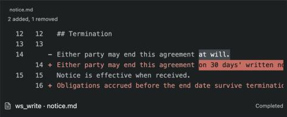

# Comparing deliveries, and what the reference projects teach

Opus, 2026-10-17. Two read-only surveys: Courtwork's diff (with live captures) and the reference projects registered at the start (SPEC §1). This is a proposal; nothing here is built yet.

## Courtwork's change language

Courtwork compares two retained revisions of a file and shows the result in one shared renderer (`Courtwork/app/web/diff-view.mjs`, styles at `app/web/styles.css:5293-5382`). The owner's ruling that shaped it (`engineering/research/motto-diff-2026-09-11/README.md`) drops green and keeps one accent: a monochrome diff, made strange on purpose so the eye lands only on what is new.

The grammar:

- **Three tiers.** Context and removed lines are grey text. An added line is accent text. Only the words that are actually new get a solid accent block with dark ink. Removed words sit on a neutral grey block, never a second hue.
- **Colour is never the only carrier.** Every row keeps a `−`/`+` mark and two line-number columns (old, new). Under forced colours, removed words get an outline.
- **The accent means changed text, nothing else.** It is not error, danger or review, and it is registered apart from the attention colour.
- **Word marks only where they are meaningful.** Word-level blocks appear only when exactly one removed line is followed by exactly one added line; longer replacements show whole lines. Whitespace between two changed words joins them into one block; indentation is never marked; a block starts and ends on visible text.
- **One summary line:** "2 added, 1 removed", or "No changes."
- **Honest limits.** Each side is capped (64 KiB, 2000 lines, a time budget). Over the cap the result is "limited", with the reason and no rows, and the UI says to read either exact version instead. A truncated diff is never shown as complete.
- **Exact ends, read-only.** Both sides are named revisions with their sha256, never an implicit "latest", and there is no accept action.

The owner's own reference screenshots are in Courtwork at `engineering/research/motto-diff-2026-09-11/user-mono-diff*.png`; the full settings capture is [here](reference/courtwork-diff-live.jpg).

## Proposal: Compare in Gleaner

**Where.** In Deliveries, when an artifact has two versions with bytes Gleaner holds (a saved copy, or the file on disk matching a delivery's hash), each row gets *Compare with selected*. When the file on disk has changed since the selected delivery, the hand-off panel offers *Compare with the file on disk*. Both ends are named in the header: "Delivery 3 → Delivery 5", each with its short hash and where its bytes came from.

**What it shows, by kind** (the ten kinds of rulings §7a):

| Kind | Comparison |
|---|---|
| Documents (text, Markdown), Code, Data (text formats) | Courtwork's three-tier line diff, in place of the preview |
| Images | The two versions side by side at the same scale, with sizes |
| Everything else | Size and hash for each end: "These bytes differ" or "Same content" |

**Language.** Adopt Courtwork's grammar as written above, including its limits and its rule that the accent means changed text only. Gleaner's palette already gives amber to "needs your look", red to "lost" and blue to selection, so the change accent becomes a fourth role with its own token. It can keep Courtwork's red because Lost never appears inside a comparison and always carries its ✕ mark and its word.

**Mechanics.** Line diff with Swift's `CollectionDifference` over lines, word diff over tokens for 1:1 line pairs, both on a background task with Courtwork's caps. Comparison is read-only and keeps no state.

**Not proposed:** semantic or Markdown block-aligned diff (a Courtwork research note, never shipped), three-way merge, accepting or reverting from the comparison.

## What the reference projects teach

Projects surveyed: Obelisk, agentsview, plannotator/artifact-server, agentuse/artifacts (the nearest match for the "Asset Viewer" named at the start), Cass, Vibe Kanban, and the native references already in [native interaction](native-interaction.md). None of them answers "which version am I looking at", which is Gleaner's question.

| Lesson | From | Status in Gleaner |
|---|---|---|
| Rereading a log must not erase known session metadata | Obelisk (an early bug) | **Fixed now**: session title and cwd are kept when a reread lacks them (`RegistryTests`) |
| Per-file cursor and per-file transactions, so one bad log never blocks the index | Obelisk | Already: per-log transactions, unchanged logs skipped by size and mtime |
| Identical re-submission is a no-op; entries open after the source is gone | agentuse/artifacts | Already: content-addressed saved copies; deliveries keep their bytes |
| Ten-ish fixed categories; render a few types, download the rest | Manus, agentuse | Adopted as rulings §7a |
| A file links to the message that changed it | agentsview "Recent Edits" | Already: the Reply section and "Delivered with" |
| Ship via GitHub Releases plus a Homebrew cask; Sparkle later | agentsview, Maccy, Obelisk | Next, after the owner's tag and notarization |

Not taken from any of them: analytics and cost, memory or recaps, agent-facing query helpers, hosted sharing, comments and review, orchestration, and requiring agents to submit files. Gleaner stays passive discovery plus human hand-off.
